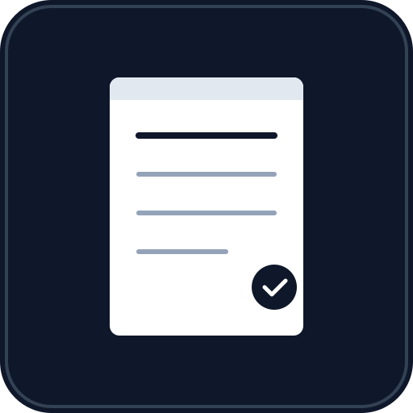

# 📝 Catatanku — Aplikasi Catatan & Pengingat

<p align="center">
  
</p>

<p align="center">
  <strong>Aplikasi catatan dan pengingat pribadi berbasis PWA.</strong><br>
  100% offline — semua data tersimpan lokal di perangkatmu.
</p>

<p align="center">
  
  
  
  
</p>

---

## ✨ Fitur

| Fitur | Deskripsi |
|---|---|
| 📝 **Catatan** | Buat, edit, dan hapus catatan dengan mudah |
| ✅ **Checklist** | Buat daftar tugas (to-do list) dalam catatan |
| ⏰ **Pengingat** | Atur pengingat dengan waktu tertentu |
| 🔁 **Pengingat Berulang** | Harian, mingguan, atau bulanan |
| 📌 **Sematkan** | Pin catatan penting ke bagian atas |
| 🗄️ **Arsip** | Arsipkan catatan yang sudah selesai |
| 🏷️ **Label** | Organisasi catatan dengan label warna-warni |
| 🎨 **Warna Catatan** | 8 pilihan warna latar belakang catatan |
| 🔍 **Pencarian** | Cari catatan berdasarkan judul, isi, atau checklist |
| 📊 **Sortir** | Urutkan berdasarkan terbaru, terlama, A-Z, atau pengingat |
| 📤 **Ekspor** | Backup semua data ke file JSON |
| 📥 **Impor** | Restore data dari file JSON backup |
| 📴 **Offline** | Berfungsi penuh tanpa koneksi internet |
| 📲 **Installable** | Bisa dipasang di home screen Android/iOS |
| 🔔 **Notifikasi** | Notifikasi browser saat pengingat aktif |
| 📳 **Vibration** | Getaran HP saat pengingat (mobile) |
| 📱 **Responsif** | Tampilan optimal di HP, tablet, dan desktop |

---

## 📸 Screenshot

> Buka `index.html` di browser untuk melihat tampilan langsung.

---

## 🚀 Cara Menjalankan

### Prasyarat
- Browser modern (Chrome, Edge, Firefox, Safari)
- [Node.js](https://nodejs.org/) (opsional, untuk local server)

## 📲 Install di Android

1. **Deploy** ke hosting (lihat bagian [Hosting](#-hosting-gratis))
2. Buka URL di **Chrome Android**
3. Muncul banner **"Install Catatanku"** → ketuk **Install**
4. Atau ketuk **⋮ Menu → "Add to Home Screen"**
5. Ikon muncul di home screen — buka seperti app biasa! 🎉

---

## 📁 Struktur Proyek

```
catatanku/
├── index.html              # Halaman utama
├── style.css               # Styling (mobile-first, responsif)
├── app.js                  # Logika aplikasi + PWA
├── manifest.json           # Web App Manifest
├── service-worker.js       # Service Worker (offline cache)
├── generate-icons.html     # Tool generate ikon PNG
├── README.md               # Dokumentasi
└── icons/
    ├── icon.svg            # Ikon vektor (scalable)
    ├── icon-72.png         # Ikon 72×72
    ├── icon-96.png         # Ikon 96×96
    ├── icon-128.png        # Ikon 128×128
    ├── icon-144.png        # Ikon 144×144
    ├── icon-152.png        # Ikon 152×152
    ├── icon-192.png        # Ikon 192×192
    ├── icon-384.png        # Ikon 384×384
    └── icon-512.png        # Ikon 512×512
```

---

## 💾 Penyimpanan Data

Semua data disimpan menggunakan **LocalStorage** di browser/device.

- ✅ **Tidak ada server** — data tidak pernah dikirim ke mana pun
- ✅ **Privasi terjamin** — hanya tersimpan di perangkatmu
- ✅ **Offline** — tidak butuh koneksi internet
- ⚠️ **Batasan** — ~5-10 MB per domain (cukup untuk ribuan catatan)

### Backup & Restore

- **Ekspor:** Sidebar → 📤 Ekspor → file JSON ter-download
- **Impor:** Sidebar → 📥 Impor → pilih file JSON

---

## ⌨️ Keyboard Shortcuts

| Shortcut | Aksi |
|---|---|
| `Ctrl + N` | Buat catatan baru |
| `Ctrl + F` | Fokus ke kotak pencarian |
| `Ctrl + Enter` | Simpan catatan (di dalam modal) |
| `Esc` | Tutup modal/dialog |

---

## 🛠️ Teknologi

- **HTML5** — Struktur semantik
- **CSS3** — Flexbox, Grid, CSS Variables, animasi
- **JavaScript** (Vanilla) — Tanpa framework/library
- **PWA** — Service Worker, Web App Manifest
- **LocalStorage** — Penyimpanan data lokal

---

## 📄 Lisensi

Proyek ini dilisensikan di bawah [MIT License](LICENSE).

```
MIT License

Copyright (c) 2026

Permission is hereby granted, free of charge, to any person obtaining a copy
of this software and associated documentation files (the "Software"), to deal
in the Software without restriction, including without limitation the rights
to use, copy, modify, merge, publish, distribute, sublicense, and/or sell
copies of the Software, and to permit persons to whom the Software is
furnished to do so, subject to the following conditions:

The above copyright notice and this permission notice shall be included in all
copies or substantial portions of the Software.

THE SOFTWARE IS PROVIDED "AS IS", WITHOUT WARRANTY OF ANY KIND, EXPRESS OR
IMPLIED, INCLUDING BUT NOT LIMITED TO THE WARRANTIES OF MERCHANTABILITY,
FITNESS FOR A PARTICULAR PURPOSE AND NONINFRINGEMENT. IN NO EVENT SHALL THE
AUTHORS OR COPYRIGHT HOLDERS BE LIABLE FOR ANY CLAIM, DAMAGES OR OTHER
LIABILITY, WHETHER IN AN ACTION OF CONTRACT, TORT OR OTHERWISE, ARISING FROM,
OUT OF OR IN CONNECTION WITH THE SOFTWARE OR THE USE OR OTHER DEALINGS IN THE
SOFTWARE.
```

---

<p align="center">
  Dibuat dengan ❤️ menggunakan HTML, CSS & JavaScript
</p>
